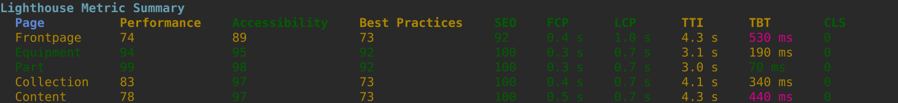
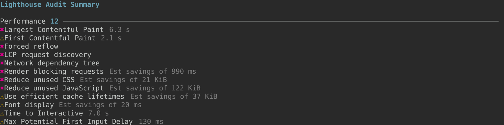
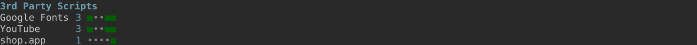

# Dashkit

[](https://github.com/oct-cr/web-audit-tool/actions/workflows/quality.yml)
[](LICENSE)

Dashkit is a Lighthouse-based CLI and terminal interface for auditing groups of related
web pages. It turns raw reports into compact summaries that help SEO, development, and QA
teams spot performance problems and regressions.



## Features

- Audit every page in a site or workspace through PageSpeed Insights.
- Compare the two latest snapshots for a page.
- Summarize Lighthouse metrics, improvement opportunities, and third-party scripts.
- Browse results in an interactive terminal interface.
- Export concise Markdown reports for agents and other automation.
- Keep configurations and reports isolated in local workspaces.

## Installation

Dashkit requires Python 3.10 or newer.

```bash
git clone https://github.com/oct-cr/web-audit-tool.git dashkit
cd dashkit
python -m venv .venv
source .venv/bin/activate
python -m pip install .
```

On Windows PowerShell, activate the virtual environment with
`.venv\Scripts\Activate.ps1`.

For an editable contributor installation with the test and quality tools:

```bash
python -m pip install -e ".[dev]"
```

## Quickstart

Dashkit reads URL batches from `workspaces/<key>.yaml`. Workspace configuration and
generated reports are ignored by Git.

Create `workspaces/demo.yaml`:

```yaml
name: Demo
sites:
  python:
    name: Python
    pages:
      home:
        url: https://www.python.org/
      downloads:
        url: https://www.python.org/downloads/
```

Verify the configuration without credentials or network requests:

```bash
dashkit -w demo lighthouse python --dry
```

The `python` route matches the site key and prints both configured URLs. To run the
audits, add a PageSpeed Insights API key to an ignored `.env` file:

```dotenv
PAGESPEED_API_KEY=your-pagespeed-api-key
```

Then collect reports and open the interactive viewer:

```bash
dashkit -w demo lighthouse python
dashkit -w demo tui
```

Other useful commands:

```bash
dashkit -w demo print python
dashkit -w demo print python:home --vs
dashkit -w demo export python:home --stdout
```

## Widget samples

## Metric Summary


## Audit Summary



## Discrepancy Table

Shows missing elements across a group.

Example: third-party scripts running across pages.



## Development

Run the same checks used by CI:

```bash
source .venv/bin/activate
make check
```

This runs Ruff, pytest, Vulture, and MyPy.

## Roadmap

[Product-value issues](https://github.com/oct-cr/web-audit-tool/issues?q=is%3Aissue%20state%3Aopen%20label%3A%22product%20value%22)
track planned improvements.

## License

Dashkit is available under the [MIT License](LICENSE).
