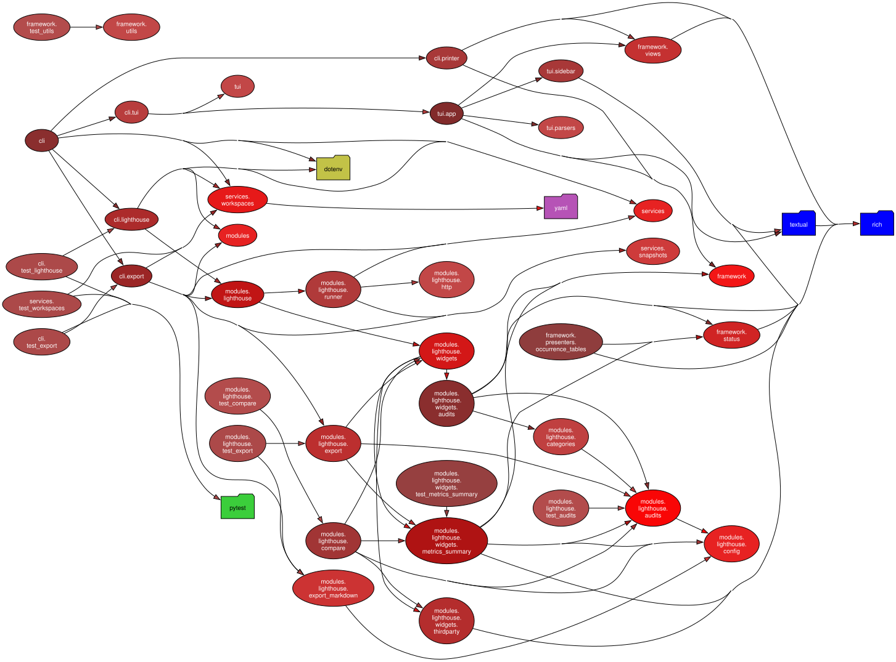

# Dependency Graphs

## Pydeps dependency graph

This chart is generated using [`pydeps`](https://github.com/thebjorn/pydeps) 3.0.2 and
Graphviz 14.1.2. `make docs-deps` verifies both versions before updating the chart.

## Mermaid architecture graph

[Mermaid architecture graph](./arch-code-diagram.mmd)
